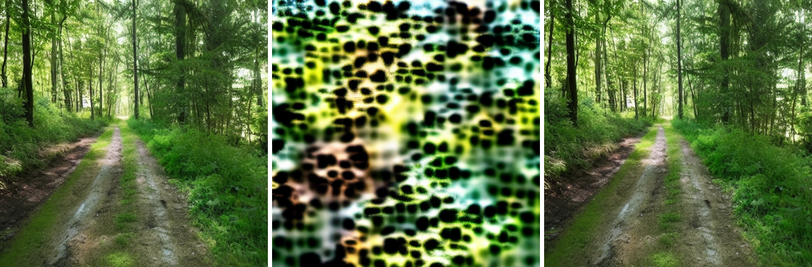

<h1 align="center">Psychedelic Vision Study</h1>

<p align="center">Can a frozen Stable Diffusion model turn a forest road into organized geometry and recover the same view?</p>

<p align="center">
   <a href="https://mahfujmustafa.dev/research/psychedelic-model">Official study site</a> ·
   <a href="https://doi.org/10.5281/zenodo.24592604">Paper on Zenodo</a> ·
   <a href="docs/project-study/README.md">Explore the research guide</a> ·
   <a href="#reproduce-the-study">Reproduce the study</a>
</p>

<p align="center">
   <a href="assets/forest-road-seed-0.gif"></a>
   <br>
   <sub>Seed 0 · Frame 00: first render · Frame 13: peak · Frame 39: return</sub>
   <br>
   <a href="assets/forest-road-seed-0.gif">Watch the full 40-frame sequence</a>
</p>

## What the study found

**The road came back in all three runs. The peak produced repeating texture and fell short of the geometry, symmetry, and sustained-motion targets.**

Inspired by theories of psychedelic perception, the experiment uses a simulated dose to change photo weighting, caption guidance, frame feedback, denoising strength, and gain in the first U-Net down block. Every frame reuses the same photo, caption, and frozen Stable Diffusion 1.5 model. The three seeds test how starting noise affects this one scene.

| Seed | Peak repetition | Final pixel error (RMSE) | Final detail match | Archive |
| --- | ---: | ---: | ---: | --- |
| 0 | 0.99 | 0.0241 | 0.852 | [Frames](results/seed-0/frames) · [Config](results/seed-0/config.yaml) |
| 1 | 2.69 | 0.0329 | 0.813 | [Frames](results/seed-1/frames) · [Config](results/seed-1/config.yaml) |
| 2 | 1.71 | 0.0262 | 0.872 | [Frames](results/seed-2/frames) · [Config](results/seed-2/config.yaml) |

Return required RMSE ≤ 0.05 and detail match ≥ 0.80 against each seed's first render. Fine detail faded before the planned cutoff, and peak repetition averaged 1.80 against a target above 5. In a separate experiment, moving the starting noise increased motion and the resulting full run missed both return thresholds. [Full results and controls](docs/project-study/experiments/results.md)

## Navigate the research guide

The [research guide](docs/project-study/README.md) is the index for the paper, experiment records, and study notebook. Start with the route that matches what you want to do.

| I want to… | Where to start |
| --- | --- |
| Read the study | The paper covers the question, methods, and findings. [PDF](docs/project-study/paper/forest-road-preprint.pdf) · [Web manuscript](docs/project-study/paper/manuscript.md) |
| Verify a result | Check the frame-by-frame and seed-by-seed results, then use the metric definitions and downloadable evidence. [Results](docs/project-study/experiments/results.md) · [Metrics](docs/project-study/experiments/measurements.md) · [Evidence ZIP](docs/project-study/paper/forest-road-supplement.zip) |
| Follow the experimental decisions | See how the controls were chosen and why follow-up probes stopped, including the test that injected a hexagonal lattice into the U-Net. [Experiment design](docs/project-study/experiments/design.md) · [Lattice injection](docs/project-study/experiments/lattice-probe.md) |
| Understand the implementation | The notebook traces a frame from latent encoding to output, then walks through scoring and follow-up probes. [Study notebook](docs/project-study/README.md#study-notebook) |
| Browse the writing process | Read earlier explanations and working notes behind the manuscript. [Working drafts](docs/project-study/drafts/README.md) |

## Reproduce the study

### Score the archived frames

Run these commands from the repository root with Python 3.11. The probe scores the start, peak, and return alongside synthetic controls without loading model weights. The verification script checks the implementation.

```sh
python3.11 -m venv .venv
.venv/bin/python -m pip install -r requirements.txt
.venv/bin/python tests/probe_apex_structure.py results/seed-0/frames 0 13 39
scripts/verify.sh
```

### Re-render the three runs

The archived configs use Apple Silicon (PyTorch MPS) and include the recorded caption. The first run downloads Stable Diffusion 1.5 weights.

```sh
.venv/bin/python run.py results/seed-0/config.yaml
.venv/bin/python run.py results/seed-1/config.yaml
.venv/bin/python run.py results/seed-2/config.yaml
```

The runs write PNG frames, a resolved config, an MP4, and a GIF to `output/fall3/`, `output/closure_seed1/`, and `output/closure_seed2/`, respectively.

## Code map

- [`run.py`](run.py) drives the render sequence. [`src/core/`](src/core/) defines the schedule and controls.
- [`src/render/`](src/render/) contains the diffusion pipeline and U-Net hooks. [`src/measure/`](src/measure/) scores frames and assembles videos.
- [`configs/`](configs/) holds experiment settings, [`resources/`](resources/) holds inputs, and [`tests/`](tests/) holds probes and checks.

## License and citation

The code and configuration files are available under the [MIT License](LICENSE). The original paper, study notes, figures, and experiment data by Mahfuj Mustafa are available under [CC BY 4.0](https://creativecommons.org/licenses/by/4.0/). The source images in `resources/` and other third-party materials are excluded from these grants.

Mustafa, Mahfuj. (2026). *Can a forest road turn into organized geometry and come back?* (Version 1.0) [Preprint]. Zenodo. [10.5281/zenodo.24592604](https://doi.org/10.5281/zenodo.24592604)

Use the top-level metadata in [CITATION.cff](CITATION.cff) to cite the software.
