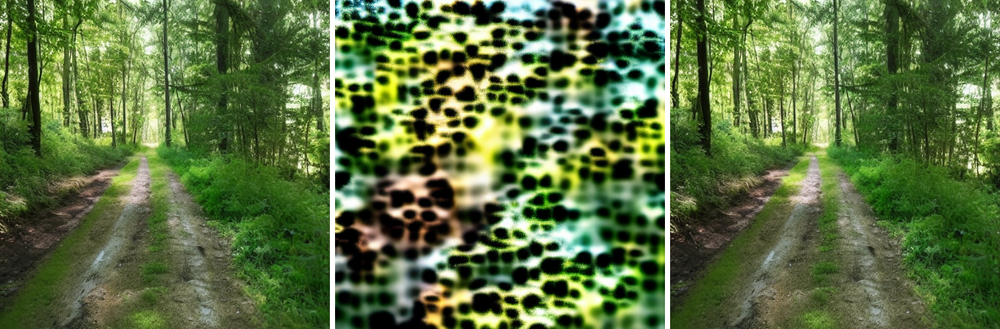

# Can a forest road turn into organized geometry and come back?

**Mahfuj Mustafa**  
Independent student research

## Abstract

I started a frozen Stable Diffusion 1.5 model from a photo of a forest road and asked how far it could get from that scene while the prompt still described the same road. My prediction was that changing the weight of the photo, the caption and the model's own activity could produce a period of organized geometry, followed by a return to the starting scene. Dose here is a number I feed the model. It sets how the knobs move over 40 frames. I ran the same schedule at three starting seeds. At peak, all three renders developed more periodic texture than the photo. The average spectral bump was 1.80 against 0.44 for the photo, below my target of 5. Reflection and rotation scores stayed near zero. When the dose fell, all three runs passed both tests for return to the first rendered frame. Mean pixel error was 0.0277 and mean fine-detail match was 0.846. A separate intervention made the peak move more, but its full arc missed return. The result is a reversible transition into repeating texture on this photo. The experiment also gives me a place to look for why the stronger prediction failed. Even a symmetric lattice put directly into the first UNet block lost its symmetry by the time it reached the image.

## 1. The question

Look at the left panel below. The dirt road widens toward the bottom and the trees meet over it. Now look at the middle panel and try to follow those same edges. That's one question I can ask of a render. Here's a harder one. Once I lose the trees, what takes their place? A bright patch repeating across an image could look impressive and still tell me very little about why people report seeing tunnels, lattices or spirals.

*Figure 1. Left to right, frames 00, 13 and 39 of the seed 0 deliverable run. Frame 13 is the four-minute dose peak. Frame 39 is at twelve minutes. The three panels are archived renders at their original resolution with space added between them. The left panel is already one pass through the model.*

Two ideas got me interested in this. Carhart-Harris and Friston proposed that psychedelics can loosen the weight given to high-level beliefs. An image model gives me something I can actually turn down, the guidance it gets from the words in a caption. Bressloff and colleagues approached geometric hallucinations from another direction. They studied how connections in a model of visual cortex can organize activity in space. Their model gives neighboring points a particular relationship. My gain knob just multiplies a block's output. It was an open question whether the wiring already inside a trained image model would do enough of the spatial work for me. [Carhart-Harris and Friston, 2019](https://doi.org/10.1124/pr.118.017160) · [Bressloff et al., 2001](https://doi.org/10.1098/rstb.2000.0769)

My original question included the ordering of geometry, forms and figures on the way back to a scene. Earlier depth tests in this project produced no figures, even at the bottleneck. For this experiment I narrowed the target to something I could score. In one run, could I keep detail through the early rise, get organized geometry with motion at peak, and come back close enough that the little edges of the original render lined up again?

## 2. Materials and methods

### How I made a frame

I used one 512 by 512 forest-road image and a frozen Stable Diffusion 1.5 model. BLIP captioned the photo. After filtering terms that could give the model the answer, the caption was "a view of a dirt road in the middle of a forest." It stayed the same throughout. Latent diffusion does the denoising in a compressed representation of an image. That let me intervene while the image was being built and still measure the result in pixels. [Rombach et al., 2022](https://openaccess.thecvf.com/content/CVPR2022/html/Rombach_High-Resolution_Image_Synthesis_With_Latent_Diffusion_Models_CVPR_2022_paper.html)

The VAE encodes the photo. Some of the previous render can feed in alongside it. I add noise to that blend and denoise it with 30 DDIM steps. During those steps a forward hook changes the output of one UNet block. The forward signal continues down the network and the block's skip copies still go across to the up side. After decoding, the feedback path matches the rendered frame's average color and contrast to the photo. The original photo comes in fresh every frame.

| Control | What it stands for here | Setting in the reported config |
|---|---|---|
| Scene precision | Weight on the incoming sensory evidence | Photo weight ranges from 0.85 down to 0.40 |
| Prior precision | Weight on the caption's high-level expectation | Guidance ranges from 12 down to 6 |
| Gain | How strongly a layer's existing features fire | Gain follows 1 + 1.8 times dose, with soft clipping |
| Depth | Which level of the hierarchy gets that gain | Fixed at the first down block, index 0 |
| Recurrence | How much of what I just made feeds back in | Previous-frame weight ranges from 0 to 0.12 |

Five controls in the design, four moving in this config. One dose curve rises to its peak at four simulated minutes and falls more slowly over the rest of the twelve-minute arc. Denoise strength follows the curve too, from 0.45 to 0.82. That detail matters when I try to explain the results. At peak I both amplify the block and give the model a noisier starting point. This run measures what those changes do together. It can't tell me how much credit each deserves.

### What I held fixed

Arm A is the main test. I used no spatial warp, drew no geometry and kept the photo weight above zero. Seeds 0, 1 and 2 each got a full arc of 40 frames in float32 on MPS. The same noise realization anchors the ordinary run within each seed. Arm B is a separate test with a log-polar map added as an explicit assumption about visual wiring. I also ran diagnostic interventions, including an injected lattice and a moving noise input. None counts as spontaneous geometry in arm A.

I used the criteria recorded in the project before the runs they judged. A single config had to meet the whole deliverable. Frames tell me when a change happens within an arc. Seeds tell me how much the result moves with starting noise on this photo. I report individual seed values or means with sample standard deviations. I didn't treat neighboring frames as independent observations. The run criteria and reporting-session checks are summarized in the supplementary report.

### How I scored it

For repetition I measured how far a peak in the spatial frequency spectrum stuck up above the image's fitted background trend (M-1). I also compared each image to reflected and rotated copies. That second step matters because patches can repeat at a similar spacing all over an image without forming a lattice. For fine detail I compared the orientations of small edges at corresponding positions (M-2). For motion I held all the knobs still and measured frame-to-frame change, whether it kept going, and whether adjacent patterns still lined up (M-3).

For return I needed two passes at once (M-4). Root mean square pixel error, or RMSE, measures RGB difference on a 0 to 1 scale. The limit was 0.05. The fine-detail score had to reach 0.8. In both cases the reference was frame 00 of the same seed. A beach photograph served as a different-scene control. See the metric definitions in the supplement.

## 3. Results

### The road leaves early and comes back late

At seed 0 the early-detail score was 0.672 at frame 05, 0.509 at frame 06, and down to 0.066 by frame 10. I wanted it above 0.6 through frame 11. The plan left one thing unclear here, which reference to use. Against the first render the target lasted about five frames. Against the input photo even frame 00 missed it. Either reading gives the same verdict on the come-up. I lost fine structure too early.

**Table 1. Main arm A runs.** Peak is frame 13 and return is frame 39. Pixel errors and final detail are relative to each seed's own frame 00. Each seed row is one full arc.

| Seed | Peak pixel error | Peak bump | Peak spacing (px) | Final pixel error | Final detail |
|---|---:|---:|---:|---:|---:|
| 0 | 0.2766 | 0.99 | 20.5 | 0.0241 | 0.852 |
| 1 | 0.2360 | 2.69 | 46.5 | 0.0329 | 0.813 |
| 2 | 0.2986 | 1.71 | 28.4 | 0.0262 | 0.872 |
| Different photo against each starting frame | — | — | — | 0.4427 to 0.4531 | -0.001 |

All three runs closed. Final pixel error averaged 0.0277 (SD 0.0046) and fine-detail match averaged 0.846 (SD 0.030). Seed 1 cleared the detail cutoff by 0.013. That's a small enough margin that I'd want more seeds before predicting a fourth pass. On the jittered input I only have seed 0. It came back at 0.0318 pixel error and 0.686 detail. Jitter on its own can push pixel error across the 0.05 line, so that stream was reported separately from the three steady-input runs.

### The peak has spacing. Does it have a shape?

On seed 0 the bump went from 0.42 at frame 00 to 0.99 at peak and back to 0.43 at the end. Across all three peaks the mean was 1.80 (SD 0.85). That's above the source photo at 0.44 and well short of the required bump above 5. A known hexagonal lattice scored 14.54. The spacing at the measured peak wandered from 20.5 to 46.5 pixels across seeds. There's no single wavelength I can claim to have set.

Mean left-right mirror symmetry was 0.101 (sample SD 0.059), and mean 60-degree rotational symmetry was -0.024 (sample SD 0.021), both over three seeds. Known symmetric controls scored about 0.98 to 0.99 on their matching symmetries. A flat gray input also produced repeating texture, so the effect doesn't require branches already spaced out in a photograph. I call this a saturation texture. Calling it a Klüver form constant would require spatial organization I couldn't measure here.

### What happens if I give the model some spatial structure?

Arm B gave the network a log-polar warp that could bend stripes into rings. I expected radial structure or concentration in log-polar coordinates to rise. On a flat field, concentration went from 138.7 in arm A to 49.7 in arm B (six observations per arm). Maybe gray just gave the map too little to work with. On the forest come-up, which has plenty of oriented edges, radial fraction went from 0.038 to 0.023 (three per arm). Neither input gave the predicted increase.

A more direct test was to hand block 0 a perfect hexagonal lattice with matched per-channel spread. Going in, its mirror score was 1.000. At the output, mean mirror score across eight seeds was 0.120 (sample SD 0.231). A phase-scrambled control kept the frequency content while breaking the alignment. On matched seeds, mean absolute mirror scores were 0.018 for the intact injection and 0.071 for the scrambled one. Knowing the layout at the hook didn't let me predict that layout in the pixels. The supplement includes the activation study.

### Movement at peak costs this setup its return

I held the dose high for a separate twelve-frame measurement. With ordinary starting noise, mean change was 3.686 on a 0 to 255 grayscale scale and the change rate decayed at all three seeds. I then let the starting noise drift along a deterministic path. Mean change rose to 31.726 across three seeds. Adjacent patterns still matched at 0.8922 peak correlation, compared with 0.158 for a churn control. But change was sustained at only two of the three seeds.

When I ran a whole arc with drift on, the ending looked like a forest road. Pixel error was 0.1498 and detail match was 0.028. Both missed. By the last frame the noise walk had moved away from its starting anchor. The model had the same road to work from and different noise to resolve. It drew another version of the road.

Of the six deliverable checks, return and implementation integrity passed. Early detail, geometry strength, symmetry and breakthrough dynamics missed. The integrity result is the verification recorded with the experiments. It checks that the controls worked as specified. It doesn't turn a missed image target into a pass. The supplementary report records which implementation checks passed.

## 4. Discussion

The lattice test changed how I read the middle panel of Figure 1. Looking at that panel alone, I might think the gain was too weak to make a clean pattern. But in the injection test the pattern was already perfect at the block. It still came out with almost no mirror structure. My read is that later layers use those activations to build another representation of the image. Measuring the layout before the rest of the network runs and measuring it in pixels are two different experiments. I know the transfer failed at the output. I haven't located the exact layer where it failed.

The architecture also gives me a reason to be careful with the word "emerged." A scalar gain has no unit of distance. It can amplify features at scales the network already uses, and real features have neighborhoods and shapes. So it makes sense that a repeated spacing could show up as I push gain higher. It doesn't follow that I can choose that spacing or tell it where a center should be. The seed spread, arm B comparison and injected lattice all put limits on that stronger claim.

There are a few limits built into the road itself. Every time I make a frame I feed the same aligned source photo back in. Coming home under those conditions is easier than recognizing a scene after the eyes or head have moved. I tested three seeds on one main photograph. The beach is a control for a different scene, not a second three-seed arc. And because several settings ride the same dose curve, the time course alone can't identify one knob as the cause. Most importantly, the measured thing here is an image. No participants reported experiences and no neural activity was recorded.

Two follow-ups would answer different questions. For generalization I'd keep the rules fixed and run complete arcs on several named photos, reporting every seed even when it misses. For the transfer failure I'd keep the same injected lattice and measure it after successive blocks as well as at the final image. The first asks how often the road result travels to a new scene. The second asks where the lattice stops traveling through the network. Both are proposals.

## 5. Conclusion

I could pull the render far enough away from the starting road that its fine detail almost disappeared, measure extra repetition at the peak, and bring the detail back as the dose fell. All three seeds made that round trip. The question I started with had a harder middle step, organized geometry that could hold together and move. The five-control setup missed that step, and even supplying a lattice at the first block didn't make one survive to the image. That's the boundary I can draw from these runs.

## Data, code and authorship

The accompanying [research supplement](forest-road-supplement.zip) contains the three run configs, the experiment report, the metric definitions, the activation study and the nine archived frames used for the seed comparisons. It also includes the eleven diagnostic PNGs used to check lattice transfer. Open the ZIP and start with README.txt. Figure 1 uses the three seed 0 frames. To check the peak and final pixel errors in Table 1, scale the RGB values to 0–1, subtract frame 00 of the same seed, square the differences, average over all pixels and channels, then take the square root. The [study repository](https://github.com/stafawashere/psychedelic-vision-study) holds the model implementation.

I designed the question, the controls and the thresholds. I used AI tools for coding and research assistance and to help draft this manuscript from my notes and experiment records.

## References

1. Carhart-Harris, R. L., and Friston, K. J. (2019). REBUS and the Anarchic Brain: Toward a Unified Model of the Brain Action of Psychedelics. *Pharmacological Reviews*, 71, 316–344. [Article](https://doi.org/10.1124/pr.118.017160)
2. Bressloff, P. C., Cowan, J. D., Golubitsky, M., Thomas, P. J., and Wiener, M. C. (2001). Geometric visual hallucinations, Euclidean symmetry and the functional architecture of striate cortex. *Philosophical Transactions of the Royal Society B*, 356, 299–330. [Article](https://doi.org/10.1098/rstb.2000.0769)
3. Rombach, R., Blattmann, A., Lorenz, D., Esser, P., and Ommer, B. (2022). High-Resolution Image Synthesis With Latent Diffusion Models. *Proceedings of CVPR*, 10684–10695. [Paper](https://openaccess.thecvf.com/content/CVPR2022/html/Rombach_High-Resolution_Image_Synthesis_With_Latent_Diffusion_Models_CVPR_2022_paper.html)
